<p align="center">
  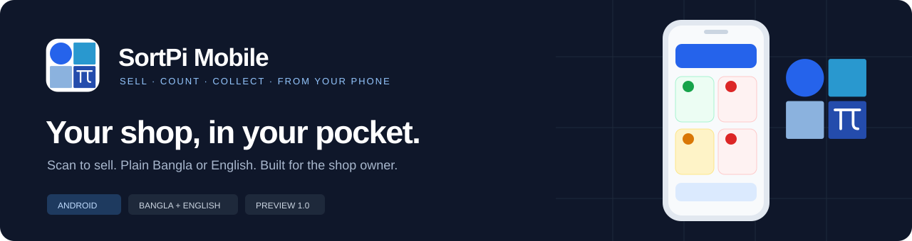
</p>

<p align="center">
  
  
  
  
  
  
</p>

<p align="center">
  <strong>The SortPi shop floor, in a shopkeeper's pocket.</strong><br />
  Scan to sell, count the shelves, collect what customers owe, and see the day — in plain Bangla or English, with colours you can read at a glance.
</p>

<p align="center">
  <a href="#get-started">Get started</a> ·
  <a href="#a-look-inside">App tour</a> ·
  <a href="#how-it-fits-together">Architecture</a> ·
  <a href="#build-a-tester-app">Tester build</a> ·
  <a href="docs/tester-guide.md">Tester guide</a>
</p>

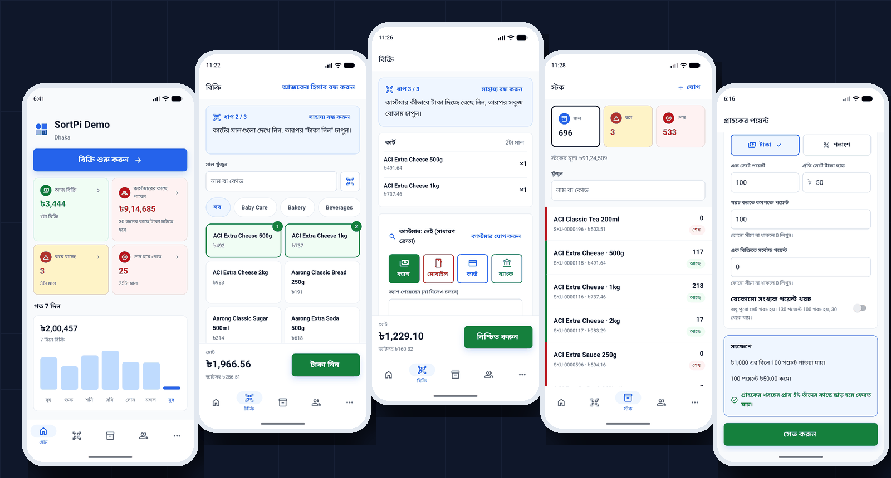

*Actual Android emulator screens in Bangla with synthetic demo-shop data. The picture shows what the app does; it is not a claim about any real shop's numbers.*

## Built for the shop owner

| Capability | What the app does |
| --- | --- |
| **Scan to sell** | Point the camera at a barcode or QR code and the item is in the cart. A carton barcode rings one carton. Type a name or code when there is no label. |
| **Plain words** | Everyday Bangla or English, chosen on first run. No jargon: "Take goods back", "Count your stock", "Ways to pay". |
| **Colour you can read at a glance** | Green is money and fine, red is owed or finished, orange is running low, blue is go. Every colour has an icon beside it, so nothing depends on colour alone. |
| **Selling that survives a bad signal** | Split payments, credit sales, hold and resume a cart, coupons, customer points, close the day. A repeated tap after a lost connection never makes a second sale. |
| **Stock you can trust** | Add an item by scanning it, count the shelves, fix differences, see every movement, catch expiry, send goods between branches and receive all or only some. |
| **Who owes whom** | Customer accounts and dues, supplier balances, purchases, returns, money in and out, and a day report. |
| **A shop you can set up** | VAT, discounts, ways to pay, customer points, coupons, shop details and logo, staff and what each person may do. |
| **Your plan, honestly** | See your SortPi plan, what you use against each limit, and how to move up. Nothing is charged in the app: pay first, then tell SortPi. |
| **Open an account from the phone** | Five short steps: your shop, you, a plan, an emailed code, a password. Nothing is created until the last step. |
| **Native behaviour** | Fingerprint lock, haptics, bottom sheets, and the Android back gesture. |

The server owns every business rule: prices, totals, tax, stock and permissions. The phone shows what it is told and asks again when unsure.

## A look inside

<table>
  <tr>
    <td width="25%" valign="top">
      <a href="docs/assets/sell.png">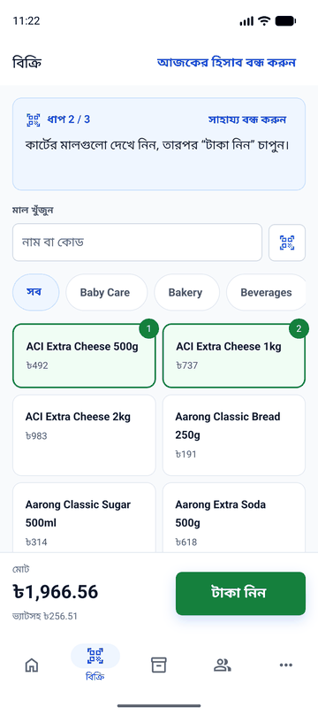</a>
      <strong>Sell by scanning</strong><br />
      Items, categories and a running total; the server confirms the real price.
    </td>
    <td width="25%" valign="top">
      <a href="docs/assets/cart.png">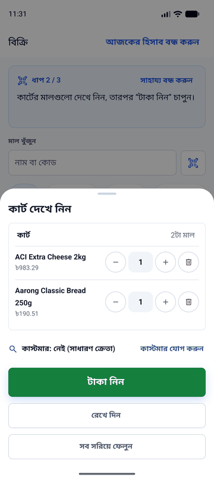</a>
      <strong>The cart</strong><br />
      Change a quantity, remove a line, hold the sale, or take payment.
    </td>
    <td width="25%" valign="top">
      <a href="docs/assets/money.png">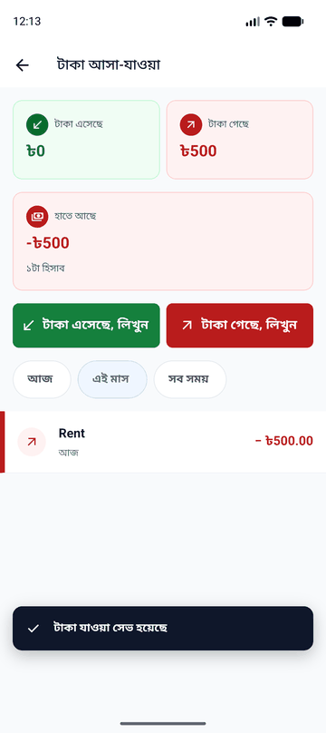</a>
      <strong>Money in and out</strong><br />
      Rent, tea and everything else, written down in a few taps.
    </td>
    <td width="25%" valign="top">
      <a href="docs/assets/signup.png">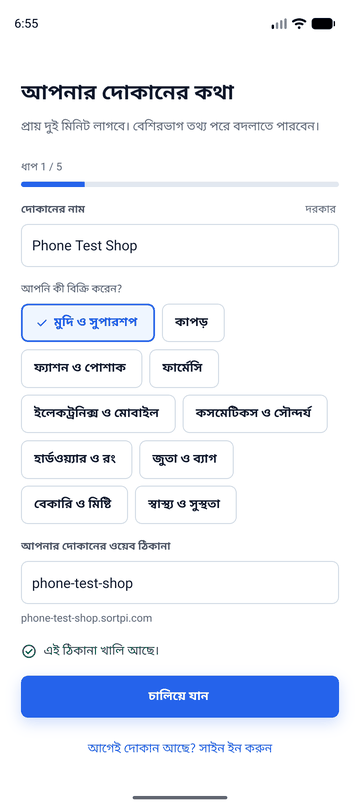</a>
      <strong>Open an account</strong><br />
      A live check says whether your shop's web address is free.
    </td>
  </tr>
  <tr>
    <td width="25%" valign="top">
      <a href="docs/assets/home.png">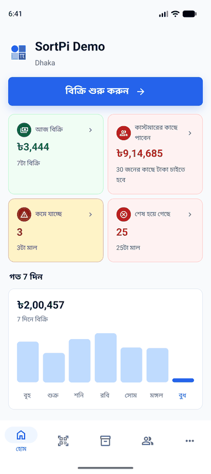</a>
      <strong>Home</strong><br />
      Today, what is owed, what is low or finished, and the week.
    </td>
    <td width="25%" valign="top">
      <a href="docs/assets/stock.png">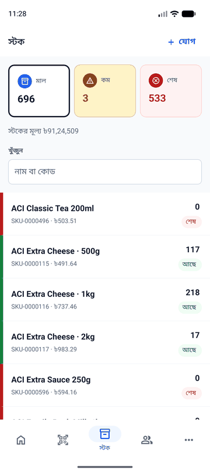</a>
      <strong>Stock</strong><br />
      What is in stock, running low or finished, with colour and icon.
    </td>
    <td width="25%" valign="top">
      <a href="docs/assets/points.png">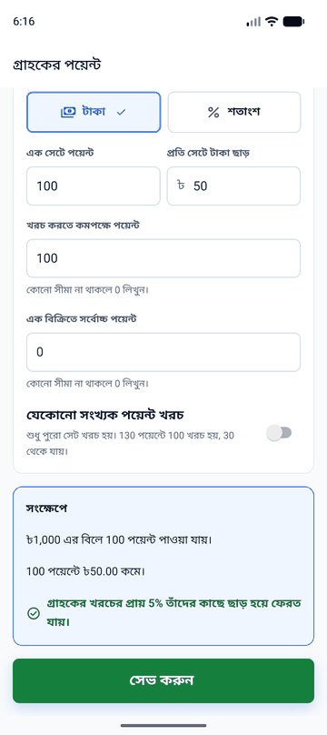</a>
      <strong>Customer points</strong><br />
      Set how points are earned and spent, with an example in plain words.
    </td>
    <td width="25%" valign="top">
      <a href="docs/assets/shop-details.png">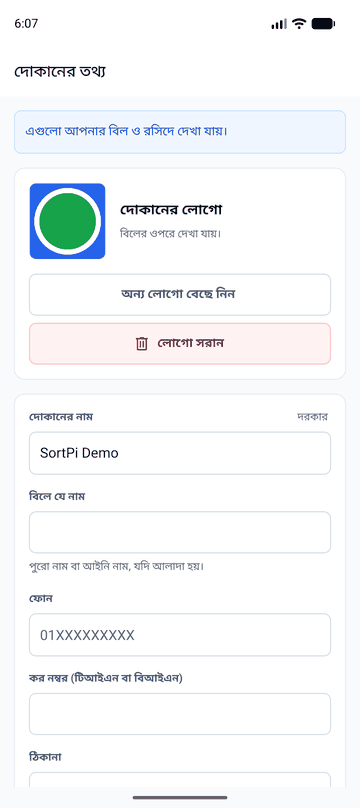</a>
      <strong>Shop details</strong><br />
      Name, phone, tax number, address and logo, shown on bills.
    </td>
  </tr>
</table>

## Get started

You need **Node.js 22 or later**, npm, Git, Android Studio with an emulator (or an Android phone), and a SortPi backend to talk to. Keep the repositories in this layout:

```text
SortPi/
├── mobile/SortPi/    # This repository
└── saas/server/      # The SortPi backend (separate repository)
```

### 1. Install and start

```sh
cd mobile/SortPi
npm ci
npx expo start
```

The app uses native modules (camera, secure storage, biometrics, photo picker), so run it as a **development build**, not in a browser:

```sh
npx expo run:android            # builds and installs on a connected device or emulator
```

The first build takes a few minutes. After that, JavaScript changes reload instantly.

### 2. Point it at a backend

For local work, run the backend (see its own README), then let the emulator reach your computer:

```sh
adb reverse tcp:8081 tcp:8081   # the app's JavaScript server
adb reverse tcp:8010 tcp:8010   # the backend (use your backend's port)
```

Choose a language, then type the shop name `http://localhost:8010` on the "Find your shop" screen. A normal shop is its name only, such as `acme`, which becomes `https://acme.sortpi.com`. Sign in with an account from your backend's seed data (see `tests/seed_users.py` in the backend repository).

**No shared login or production credentials are included, and none should be typed into a production site while developing.** Use a local or test backend.

### 3. Opening an account

On the shop-name screen, **No shop yet? Open a free account** runs the five-step sign-up. It talks to the platform's bare domain (`https://sortpi.com/api/v1`), unless your saved shop is a plain-`http` development address. **A shop made this way is a real shop on the server you are pointed at.** Point the app at a local backend first, or use clearly fake names. If someone forgets their shop name, the same screen has a **Forgot the shop name?** help.

## Colour is a language here

| Colour | Means | Always paired with |
| --- | --- | --- |
| Green | Money received, fine, on, done | a tick or a cash icon |
| Red | Owed, finished, a problem | a cross or warning icon |
| Orange | Running low, be careful | a warning icon |
| Blue | Go, the next step | an arrow or a plain button |

The design checklist walked for every screen is in [docs/design-rules.md](docs/design-rules.md): big tap targets, few fields per screen, a status for every wait, an undo or a next step after every action, and failures designed as carefully as successes.

## How it fits together

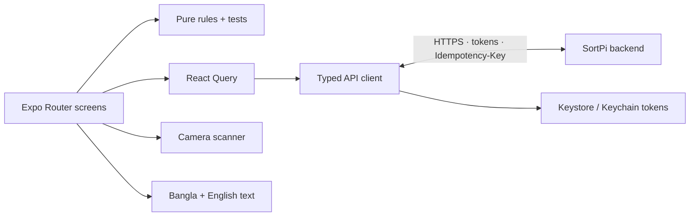

```text
src/
├── app/            Screens, one file per route (Expo Router), and the tab shell
├── components/     Shared building blocks: buttons, fields, sheets, icons
├── api/            Typed client: envelope, token refresh, idempotency, branch header
├── auth/           Session, secure storage, shop address, roles from the server
├── sell/           Cart, payment, coupons, points at the till, holds, receipts
├── sales/ products/ catalog/ stock/ movements/ expiry/ transfers/
├── customers/ suppliers/ purchases/ orders/ money/ reports/
├── admin/ team/ settings/ billing/ signup/ setup/ home/ menu/ scan/
├── i18n/           Bangla and English text, sizes for each script
├── constants/      Colours, contrast checks, type scale, fonts
└── lib/ ui/        Money, dates, haptics, toasts, connection state
docs/               Parity tables, design rules, tester guide, server requests
```

Each feature folder keeps its **rules in plain TypeScript files with tests** (`logic.ts`, `logic.test.ts`), its **server calls in `api.ts`**, and its **screens in `src/app`**. The rules run under Node with no phone attached, which is why 296 tests run in seconds.

## Rules the app keeps

- **Money is a string on the wire and a decimal in the app**, never a JavaScript number. Amounts show Bangladesh grouping (1,00,000).
- **The server prices everything.** The phone's total is an estimate until the server answers.
- **Every money-moving call carries an `Idempotency-Key`**, so a retry after a lost connection replays instead of repeating.
- **What a person sees comes from the permission list the server returns**, never from a role name.
- **Tokens live in Keychain/Keystore**, are refreshed once for many parallel calls, and are never logged or put in a URL.
- **Refusals are said in plain words**, including "your plan has reached its limit".
- **The app never edits a posted record.** Corrections are returns, reversals and counts.

## Check your changes

```sh
npm test                 # 296 unit tests: money, rules, API client, translations
npx tsc --noEmit         # type check
npx expo lint            # lint
```

There is one known lint error in `src/auth/session-provider.tsx` (setting state inside an effect) that is not part of any feature work.

Screens are checked on an Android emulator against a local backend. When sign-up sends a code by email, a local backend prints it in its console log. The parity tables record, row by row, what was seen and what was not.

## Build a tester app

```sh
cd android
NODE_ENV=production ./gradlew assembleRelease -PreactNativeArchitectures=arm64-v8a,armeabi-v7a
```

The APK is at `android/app/build/outputs/apk/release/app-release.apk` (about 64 MB). The `android/` folder is generated from `app.json` — never edit it by hand; regenerate it with `npx expo prebuild --platform android`.

- Raise `android.versionCode` in `app.json` for every upload.
- This build is signed with the standard Android **debug** key. That is fine for Firebase App Distribution testers. **Make a real upload key before the Play Store.**
- A release build only talks to `https` shops. Use a debug build (`npx expo run:android`) for a local `http` server.
- Package name: `com.geekssort.sortpi`. iPhone builds need an Apple distribution profile and are not set up.

Full steps for testers and for whoever uploads builds are in [docs/tester-guide.md](docs/tester-guide.md).

## Documentation

| Document | What it holds |
| --- | --- |
| [docs/parity/README.md](docs/parity/README.md) | One row per web feature: what the phone does, and what was and was not seen |
| [docs/design-rules.md](docs/design-rules.md) | The checklist every screen is walked against |
| [docs/parity/build-plan.md](docs/parity/build-plan.md) | The plan that ordered the phases |
| [docs/tester-guide.md](docs/tester-guide.md) | Install, what to check, how to report a problem, how to upload builds |
| [docs/server-requests/email-shop-name.md](docs/server-requests/email-shop-name.md) | A server change this app would like: "email me my shop name" |

## Project status

**A preview.** The app has been exercised on an Android emulator against a local backend, in Bangla.

- **Not yet seen:** restricted roles, a real second branch, large text, dark mode, TalkBack, a physical Pixel, and the live site (no password was typed into production).
- **Not built:** company email change, receipt and invoice design, till screen layout, weighing-scale and scanner setup, clearing test sales, SortPi's own invoices, importing transfer lines from a file, selling offline, iPhone.
- **Needs the backend:** finding a forgotten shop name by email (see the server-request plan above).

## History

The git history is built phase by phase so each step can be read on its own: foundation, API client, first run, Home, scanning, selling, products, stock, transfers, customers and suppliers, orders, money and reports, access and team, settings, your plan, sign-up, and docs. Each phase has a tag (`phase-6-selling`, `tester-build-1`, …). It was rebuilt from the finished app, so a commit holds files as they are now, not as they were first written.

```sh
git tag --list 'phase-*'                          # the milestones
git log --oneline phase-5-scanning..phase-6-selling   # one phase, for example selling
```

---

<p align="center"><strong>SortPi Mobile</strong> · Built by GeekSSort<br />A familiar counter. In your pocket.</p>
